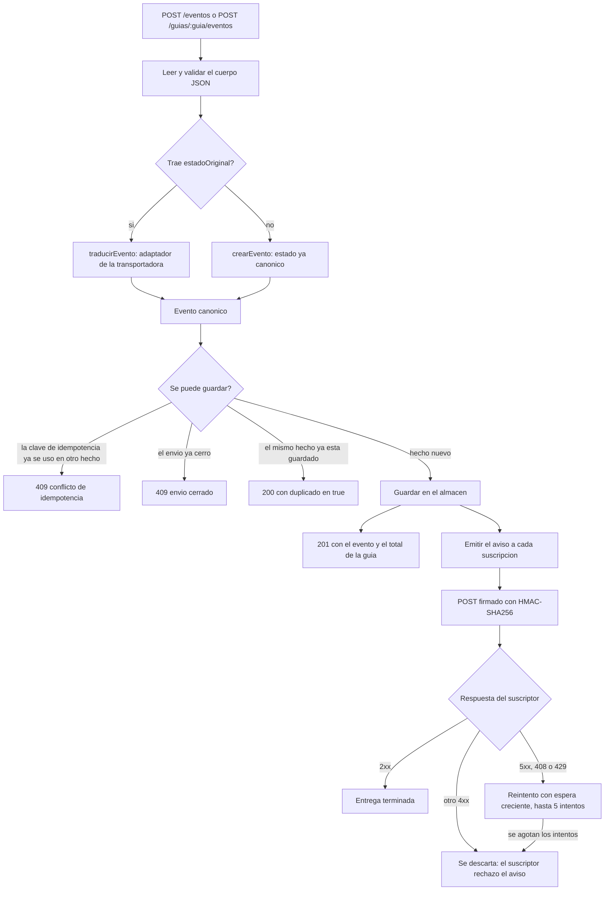
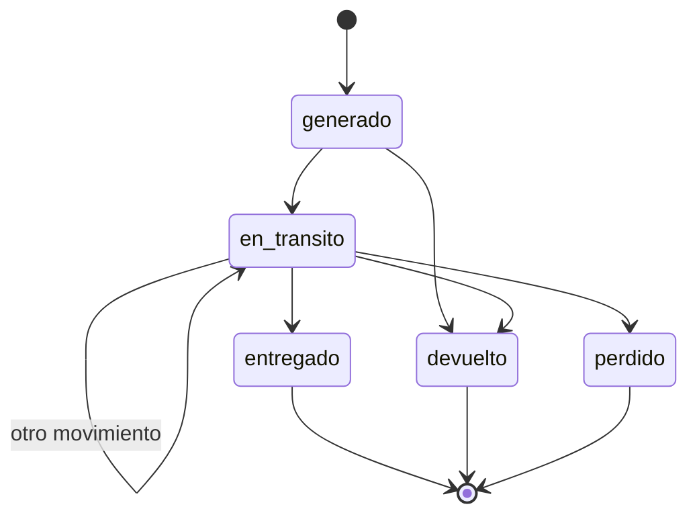

# API de rastreo de envios multitransportadora

Normaliza los estados y las fechas de las paqueterias colombianas a un modelo
comun y avisa por webhook a las otras aplicaciones del negocio.


**Stack:** Node.js 24 · node --test · sin dependencias externas

## Que resuelve

Cada transportadora cuenta el mismo viaje con sus propias palabras. Servientrega
dice `EN REPARTO`, TCC dice `EN_CAMINO`, Coordinadora manda el codigo `2`. Para
quien factura o atiende al cliente eso es ruido: necesita saber si el paquete
salio, va en camino o ya llego.

Esta API recibe ese texto crudo, lo traduce a cinco estados y guarda un
historial por guia. Cuando entra un movimiento nuevo, avisa a los sistemas
suscritos con una firma que el otro lado puede comprobar.

Estados del modelo comun:

| Estado | Significado |
|---|---|
| `generado` | La guia existe, la transportadora todavia no tiene el paquete |
| `en_transito` | El paquete se mueve: recogido, en ruta, en reparto |
| `entregado` | Llego al destinatario. Cierra el envio |
| `devuelto` | Vuelve al remitente. Cierra el envio |
| `perdido` | Extravio, siniestro o novedad sin recuperacion. Cierra el envio |

Este repositorio es parte del portafolio publico de
[InheritDevs](https://inheritdevs.com/). El codigo esta completo, se puede leer,
ejecutar y auditar. Las pruebas corren en cada push y en cada pull request.

## Flujo de un evento



El ciclo de una guia durante el viaje:



Los tres estados finales cierran el envio. Despues de un `entregado` la guia ya
no acepta movimientos nuevos.

## Instalacion

```bash
git clone https://github.com/Chencho2323/api-rastreo-envios.git
cd api-rastreo-envios
npm install
```

No hay dependencias externas: `npm install` deja listo el runner. Hace falta
Node.js 24 o superior.

## Uso

```bash
npm start                 # levanta el servidor en el puerto 3000
PORT=8080 npm start       # otro puerto
```

Rutas disponibles:

| Metodo | Ruta | Que hace |
|---|---|---|
| GET | `/salud` | Chequeo de salud del servicio |
| POST | `/eventos` | Registra un movimiento, con la guia en el cuerpo |
| POST | `/guias/:guia/eventos` | Registra un movimiento para la guia de la ruta |
| GET | `/guias/:guia` | Estado actual e historial completo |
| POST | `/suscripciones` | Registra un destino de webhook |
| GET | `/suscripciones` | Lista los destinos, sin sus secretos |
| DELETE | `/suscripciones/:id` | Borra un destino |

## Ejemplos

### 1. Salud

```bash
curl http://localhost:3000/salud
```

```json
{"estado":"ok","servicio":"api-rastreo-envios"}
```

### 2. Registrar un evento con el texto crudo de la transportadora

El adaptador traduce `EN REPARTO` a `en_transito` y conserva el texto original
en `codigoOriginal`:

```bash
curl -X POST http://localhost:3000/eventos \
  -H "content-type: application/json" \
  -H "idempotency-key: notif-001" \
  -d '{
    "guia": "GUI-9001",
    "transportadora": "Servientrega",
    "estadoOriginal": "EN REPARTO",
    "ocurridoEn": "2026-11-02T08:15:00-05:00",
    "ciudad": "Medellin"
  }'
```

```json
{
  "evento": {
    "guia": "GUI-9001",
    "transportadora": "servientrega",
    "estado": "en_transito",
    "codigoOriginal": "EN REPARTO",
    "descripcion": null,
    "ocurridoEn": "2026-11-02T13:15:00.000Z",
    "ciudad": "Medellin",
    "departamento": null,
    "datosCrudos": null
  },
  "duplicado": false,
  "totalEventos": 1
}
```

### 3. Registrar un evento ya canonico, por la ruta de la guia

Sirve cuando el sistema de origen ya hizo la traduccion. La guia de la ruta
manda y el cuerpo no la puede contradecir:

```bash
curl -X POST http://localhost:3000/guias/GUI-7777/eventos \
  -H "content-type: application/json" \
  -d '{
    "transportadora": "TCC",
    "estado": "entregado",
    "ocurridoEn": "2026-11-03T16:40:00-05:00",
    "descripcion": "Entregado a la senora del apto 302"
  }'
```

Un `POST /guias/GUI-7777/eventos` con `"guia": "GUI-9001"` en el cuerpo
responde 400 y nombra las dos guias.

### 4. Repetir el mismo hecho

El registro es idempotente. Un evento con la misma guia, transportadora, estado
y fecha no se guarda dos veces: la segunda vez responde 200 con
`"duplicado": true` y el evento que ya estaba.

La cabecera `idempotency-key` (o el campo `claveIdempotencia` en el cuerpo)
cubre el caso en que el reintento llega con un texto distinto. Reutilizar la
clave para otro hecho responde 409:

```json
{"error":"La clave de idempotencia \"notif-001\" ya se uso para otro evento.","campo":"claveIdempotencia"}
```

Un envio cerrado no acepta movimientos nuevos:

```json
{"error":"La guia \"GUI-7777\" esta cerrada en el estado \"entregado\" y no acepta eventos nuevos.","campo":"guia"}
```

La repeticion del mismo hecho si se acepta, como duplicado.

### 5. Consultar una guia

```bash
curl http://localhost:3000/guias/gui-9001
```

```json
{
  "guia": "GUI-9001",
  "estado": "en_transito",
  "ocurridoEn": "2026-11-02T13:15:00.000Z",
  "cerrado": false,
  "totalEventos": 2,
  "eventos": [
    {
      "guia": "GUI-9001",
      "transportadora": "servientrega",
      "estado": "generado",
      "codigoOriginal": "GUIA GENERADA",
      "ocurridoEn": "2026-11-01T13:00:00.000Z"
    },
    {
      "guia": "GUI-9001",
      "transportadora": "servientrega",
      "estado": "en_transito",
      "codigoOriginal": "EN REPARTO",
      "ocurridoEn": "2026-11-02T13:15:00.000Z"
    }
  ]
}
```

El numero de guia se normaliza a mayusculas y solo admite letras, numeros y
guion. Una guia sin eventos responde 404, una guia mal formada responde 400 y
nombra el campo culpable.

### 6. Suscribir un webhook

```bash
curl -X POST http://localhost:3000/suscripciones \
  -H "content-type: application/json" \
  -d '{
    "url": "https://ejemplo.com/webhooks/rastreo",
    "secreto": "minimo-16-caracteres",
    "descripcion": "Notificaciones del area comercial"
  }'
```

```json
{
  "suscripcion": {
    "id": "sus-3f9a1c72-...",
    "url": "https://ejemplo.com/webhooks/rastreo",
    "descripcion": "Notificaciones del area comercial",
    "creadaEn": "2026-11-02T14:00:00.000Z"
  }
}
```

La url tiene que usar http o https, el secreto al menos 16 caracteres y una url
no se puede suscribir dos veces (409). El secreto nunca se devuelve al leer.

### 7. Cuerpo y firma del aviso que recibe el suscriptor

```json
{
  "id": "avi-8f1c0d21-...",
  "tipo": "evento.rastreo",
  "emitidoEn": "2026-11-02T14:05:00.000Z",
  "datos": {
    "guia": "GUI-9001",
    "transportadora": "servientrega",
    "estado": "en_transito",
    "ocurridoEn": "2026-11-02T13:15:00.000Z"
  }
}
```

Cabeceras que acompanan ese `POST`:

| Cabecera | Contenido |
|---|---|
| `content-type` | `application/json; charset=utf-8` |
| `x-firma-sha256` | `sha256=<hex>` del cuerpo crudo |
| `x-evento-id` | Identificador estable del aviso, igual en todos los reintentos |
| `x-intento` | Numero de intento, empieza en 1 |

Verificacion en el lado del suscriptor:

```js
import { createHmac, timingSafeEqual } from "node:crypto";

function firmaValida(cuerpoCrudo, secreto, cabecera) {
  const esperada = `sha256=${createHmac("sha256", secreto).update(cuerpoCrudo, "utf8").digest("hex")}`;
  const a = Buffer.from(esperada, "utf8");
  const b = Buffer.from(String(cabecera ?? ""), "utf8");
  return a.length === b.length && timingSafeEqual(a, b);
}
```

La comparacion va sobre el cuerpo crudo, antes de `JSON.parse`. El `id` del
cuerpo y `x-evento-id` coinciden, asi que un reintento se puede descartar sin
volver a procesarlo.

Un 5xx, un 408 o un 429 se reintentan con espera creciente hasta cinco
intentos. Un 4xx de otro tipo no, porque el suscriptor ya rechazo el aviso. Los
avisos de una misma suscripcion salen en orden y un evento duplicado no vuelve
a avisar. Un webhook caido no retrasa ni tumba la recepcion del evento.

## Transportadoras

Cada transportadora tiene su adaptador en `src/transportadoras.js`, con la tabla
que traduce sus codigos y sus textos de novedad al modelo comun. Hoy estan
Servientrega, Interrapidisimo, TCC, Envia y Coordinadora.

```js
import { traducirEvento } from "./src/transportadoras.js";

traducirEvento({
  transportadora: "Servientrega",
  guia: "gui-9001",
  estadoOriginal: "EN REPARTO",
  ocurridoEn: "2026-11-02T08:15:00-05:00",
});
// estado: "en_transito", codigoOriginal: "EN REPARTO"
```

Las dos formas de entrada, codigo y texto, se resuelven en el mismo adaptador.
Un estado que no este en la tabla no se adivina: el adaptador falla y nombra el
valor original para que se agregue la equivalencia.

```js
traducirEvento({
  transportadora: "Coordinadora",
  guia: "gui-9002",
  estadoOriginal: "EN BODEGA DE DESTINO",
  ocurridoEn: "2026-11-02T09:00:00-05:00",
});
// ErrorDeValidacion: La transportadora "Coordinadora" reporto el estado
// "EN BODEGA DE DESTINO", que no tiene equivalente en el modelo.
// Falta agregarlo al adaptador.
```

## Configuracion

Se lee del entorno:

| Variable | Por defecto | Para que |
|---|---|---|
| `PORT` | `3000` | Puerto del servidor |
| `NODE_ENV` | `desarrollo` | Ambiente que se reporta al arrancar |
| `RUTA_BASE_DATOS` | `datos/rastreo.sqlite` | Ruta que usara el almacen persistente |

Hoy el almacen guarda en memoria y pierde el historial al reiniciar el proceso.
La interfaz de `src/almacen.js` es la que va a usar SQLite, para que el resto
del codigo no cambie cuando se conecte.

## Pruebas

```bash
npm test        # runner de Node, sin dependencias
./verificar.sh  # el mismo gate que corre el CI
```

## Estructura

```
src/        codigo de la aplicacion
  app.js            servidor HTTP y rutas
  almacen.js        guarda los eventos por guia
  registro.js       deduplica eventos y aplica la idempotencia
  consulta.js       arma el estado actual y el historial de una guia
  webhooks.js       suscripciones, firma HMAC y reintentos
  transportadoras.js  adaptadores y mapeo de estados
test/       pruebas automaticas
```

## Licencia

MIT. Ver `LICENSE`.
